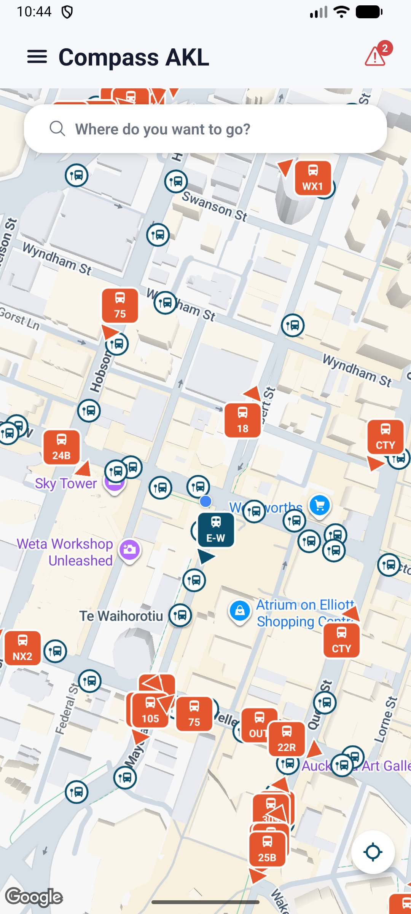
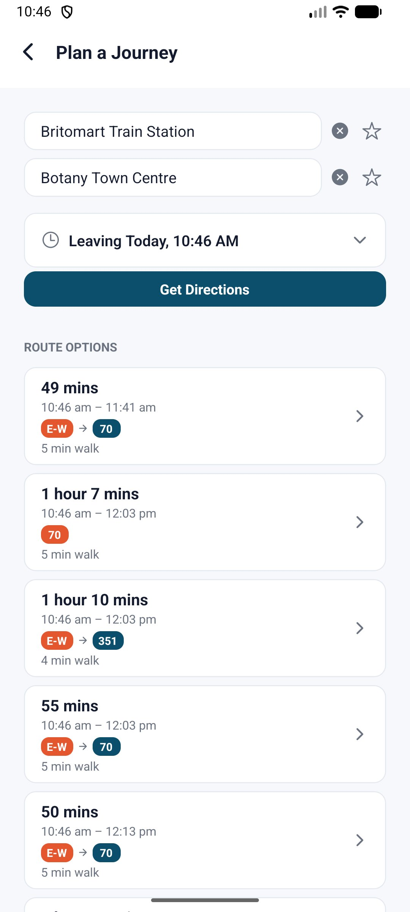
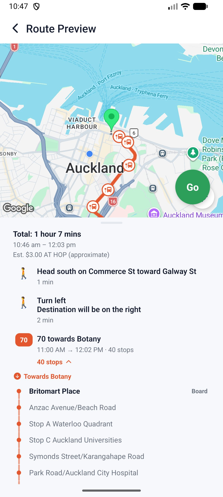
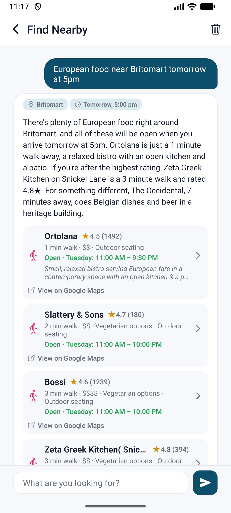

# Compass AKL

A personal, from-scratch alternative to Auckland Transport's official app, and more than a transit app now — live vehicle tracking, journey planning with real-time GPS step tracking, background-surviving trip notifications, an offline-first schedule database, and a free-text chat for finding what's actually nearby, built solo with Expo/React Native + TypeScript.

Built against Auckland Transport's public GTFS + GTFS-Realtime APIs and Google's Routes/Places APIs. Mobile only, no web build — built and tested on Android; iOS is configured but untested (see Known limitations).

## Screenshots

<p float="left">
  
  
  
  
</p>

## Why I built this

The official app buries notification settings behind several taps and sends recurring alerts that are hard to fully turn off, and its stop map doesn't make it obvious which side of the road a stop actually sits on. I wanted something opt-in by default, with exact stop locations, and — since I was building it myself — the freedom to add features I actually wanted (like live GPS tracking during a journey, and a lock-screen notification that tells you when to get off).

## Features

- **Live map** — every bus, train, and ferry currently running, updating in real time, with mode-specific markers that point the way each vehicle is heading. Tap a vehicle for its next stop, delay status, and its route drawn on the map. The camera follows your location while the app is open and on screen (the locate button shows an arrow while it is following), stops when you drag the map away, and jumps back to you whenever you return to the app.
- **Journey planning** — multiple route options via Google's Routes API, each with duration, line badges, and walking time. Departure time is adjustable via a custom scrollable date/time picker, and From/To stay editable on the results page itself.
- **Live journey tracking** — once you start a route, your position is matched to the correct step in real time (GPS-based, with a scheduled-time fallback), the map follows you (turning to face the way you're walking on a walking leg, so a left turn on the route is a turn to the left of the screen), and a persistent notification keeps tracking even if the app is closed or the phone is locked. Each leg's own stop list is shown top to bottom, with the stop you're at and the direction of travel highlighted live — stops already passed fold behind a tap-to-expand summary instead of disappearing. **The app works out which live bus you're riding** and, from then on, shows just that bus at your own position ("You're on this bus", with its next stop and delay) and hides the others — they were only there to show whether yours was coming. They return, with the blue dot, when you get off. See "Which bus are you on?" below.
- **Boarding/alighting alerts** — a vibrating notification fires when your vehicle has just arrived at the stop before yours, then again right as you reach your own stop — driven by your live position along the route, not just a fixed time before the scheduled arrival.
- **Stop details** — live + scheduled departures merged into one list, plus any active service alerts for that stop.
- **Favourites** — save stops, places, or whole from→to trips for one-tap re-search.
- **Find Nearby (AI chat)** — ask for anything in plain English or Korean ("European food near Britomart tomorrow at 5pm", "closest cafe", "집 근처 카페") and get real places with real walk/transit times, star ratings, opening hours checked for when you'd actually arrive, and a short written answer. Can rank by best rated and filter for cheap, vegetarian or outdoor seating. Remembers the conversation for follow-ups, answers questions about the results on screen ("which is best rated?"), acts on them ("take me to the second one"), asks when a request is too vague, and understands "home", your named places ("near work") and where your planned trip ends ("dinner near my stop"). See [Find Nearby](#find-nearby--the-ai-chat) below.
- **Offline schedule data** — scheduled departures and route path geometry work without a network call, backed by a compact SQLite database built from AT's static GTFS feed (see below — AT's live API doesn't expose this data at all).
- **Experimental fare estimation** — AT publishes no machine-readable fare data, so this reverse-geocodes each leg and matches it against AT's public fare-zone boundaries, clearly flagged as an estimate.
- **Dark mode** and **English/Korean localization**, throughout.
- **Over-the-air updates** — JS-only changes ship instantly via EAS Update without needing a new app-store-style build.

## Which bus are you on?

AT's live feed says where every bus *was* when it last reported — not which one you're sitting in — and it runs behind (measured: median about 4 s, 90th percentile about 33 s, occasionally minutes). At bus speed that is hundreds of metres, so comparing a bus's reported position with *your position now* never matches. `src/services/boardedVehicle.ts` compares like with like instead: it keeps a trail of your last few minutes of GPS fixes, and asks where *you* were at the moment each bus of your line reported. A bus you're on was within about 60 m of you at its own timestamp, heading the way you were going. A match needs you to be moving like a vehicle (so standing beside a bus at a stop, or walking past one, doesn't count), and once made it holds through a stop and a few seconds of GPS drift, and ends when the bus is clearly elsewhere or leaves the feed for good.

Two details found by running it against the real feed: the feed's `speed` field is in **km/h**, not the m/s the GTFS-realtime spec says (measured against how far ~550 buses actually moved between reports: ratio 0.26, a km/h conversion is 0.28); and the journey's GPS watcher has to keep reporting while you're stationary, or "no new fix" is indistinguishable from "no signal" and the app keeps believing you're on a bus that has driven away.

## Find Nearby — the AI chat

A chat screen (side menu → Find Nearby) that takes free text in English or Korean and answers with real places, real travel times, and a short written reply. A few things it handles that a plain search box can't:

| You type | What happens |
| --- | --- |
| `closest cafe` | No time limit is invented — places are just ranked by real travel time |
| `korean bbq within 30 minutes` | Only places actually reachable in 30 minutes |
| `ramen open now` | Opening hours are checked for the moment you'd arrive, leaving now |
| `best ramen near Sky Tower` | Ranked by rating instead of distance — a 4.6★ with 800 reviews beats a 5.0★ with three |
| `cheap vegetarian lunch` / `cafe with outdoor seating` | Filtered on what Google Places actually knows about each place, shown on the result row |
| `European food near Britomart tomorrow at 5pm` | Searches around Britomart, routes for a 5pm departure tomorrow, keeps only places open then |
| `ramen near Sky Tower Friday evening` | A vague "evening" becomes a concrete 6pm for routing and opening hours |
| `cafe near home` / `집 근처 카페` | Resolves to your saved home address — not a business that happens to be called "Home" |
| `coffee near work` / `회사 근처 카페` | Resolves to a favourite place you've named "Work" (name one with the tag icon in Favourites); if there isn't one, it says how to add it |
| `dinner near my stop` (from a planned trip) | Searches around the stop your trip gets off at, for the time you'd actually be there, keeping only places open then |
| …then `which one is best rated?` | Answered from the results on screen — no new search, no new Places or Routes call |
| …then `take me to the second one` | Opens the journey planner to that place (`show the first one on the map` opens Google Maps) |
| `somewhere to eat` | Asks what kind of food you're after instead of guessing |
| …then `actually only walking` | Read as a refinement of the previous request, not a new one |

Each result shows the travel time (walk, or the transit line to take), star rating, price and the details a search can ask for (vegetarian options, outdoor seating) when Places knows them, opening hours with an open/closed flag, Google's editorial summary when there is one, and a Google Maps link; tapping a result hands off to the journey planner. Opening hours are judged at the moment you'd **arrive** (departure plus the real travel time), not when you set off — a place that shuts ten minutes after you leave isn't open for a twenty-minute walk — and one that closes within the hour after you'd arrive says so ("Closes 12 min after you arrive"). When you didn't say *when* you're going, results aren't filtered by opening hours — ones closed on arrival are shown as closed and the reply asks what time you're heading out. Places often has no price or menu data for a place; that is treated as *unknown*, never as *no*, so a "cheap" search drops places Google says are expensive but keeps (and ranks after the confirmed ones) places it has nothing on. The conversation persists across app restarts, with a trash button in the header to clear it.

**How it feels to use:** an empty chat offers tappable example prompts. While a search runs, the spinner says what it's doing (finding your location, understanding the request, searching places and travel times). The results appear as soon as the real data is in — the written summary follows as its own bubble a few seconds later instead of holding the list back, and the list stays put when it arrives, so nothing moves under your thumb mid-read. Under the latest answer sit one-tap follow-ups ("Walking only", "Open now", "Best rated", "Closest first", "Within 10 minutes", "Cheap only", "Vegetarian options", "Outdoor seating"), offered only when they would change something; each is sent as an ordinary message, so it goes through exactly the same refinement path as typing it. From a planned trip's route preview, "Find places near your stop" opens the chat already knowing where the trip ends and when.

**How a message becomes an answer:**

1. **Read the message** — the app sends the text to the Worker's `/parse-nearby`, along with the previous turn (for follow-ups), a compact numbered list of the results on screen, and the names you've given saved places. It comes back classified as a **search**, a **question** about the results, or an **action** on one of them, with — for a search — structured fields: category, time budget, travel modes, "means my home", a saved place by name, "where my trip ends", a named reference place, a target day/hour/minute, closest-vs-best-rated, and cheap/vegetarian/outdoor flags — or a clarifying question.
2. **Question or action?** A question goes to `/answer-question`, which answers from the results it's handed and nothing else. An action's target is checked against the real list (the model's "number 2" is only a claim) before the app opens directions or a map link. Neither makes a Places or Routes call.
3. **Pick the origin** — live GPS, a named place geocoded through Places Text Search, the saved home address, a named favourite place, or the stop a planned trip ends at (with its arrival time as the default time).
4. **Search and prune** — Places finds candidates two ways and merges them: Text Search by the words in the category (catches a shop with the right name) and Nearby Search by Google's own place type, which the parser picks (catches a chain whose name never says what it sells — "burger place" finds McDonald's and Carl's Jr this way, which a text search for "burger" never does). A brand or a specific shop skips the type search and is found by name. Straight-line distance (free) then cuts the pool to 8 — the closest, or for a "best" search the highest quality score (a rating pulled toward the average until it has real review volume) — so only those cost a Routes API call.
5. **Route and rank** — real walk or transit times for the requested departure, opening hours matched against the arrival moment, ranked by travel time (or by quality for "best"). Travel time is whole minutes, so places often tie; between equally close ones the better-known (more reviews) comes first.
6. **Explain** — the final list goes to `/explain-results`, which writes 2–4 sentences describing it. It can describe results; it can't add any.

The model reads the message in step 1 and describes results in steps 2 and 6 — everything in between is real map data and deterministic code (`src/services/nearbyRanking.ts` and `nearbyConversation.ts`, unit-tested), and the whole turn is orchestrated in `src/services/nearbyTurn.ts`. The Worker is documented in [server/README.md](server/README.md).

**What leaves the phone:** to read and answer a message, the chat sends the message text, the places it found (names, ratings, hours, price) and any names you've given saved places to Anthropic's Claude, through a Cloudflare Worker that holds the API key. Your GPS position and home address are never sent, and neither is an unnamed favourite. The same note is shown on the empty chat and in the About screen.

**Abuse protection:** the Worker's URL ships inside the app, so anyone can find it. Each install sends a random id (`X-Install-Id`, not a secret and not an account) and is rate-limited by it, with a looser per-IP ceiling so a shared network isn't treated as one caller; a request without an id is limited by IP alone, more tightly. Bodies over 32 KB are refused before they're parsed. These are Cloudflare Rate Limiting bindings, which are per location and eventually consistent — they blunt bursts, they don't meter exactly — so the cap on the Anthropic key remains the hard backstop on spend. Real app attestation (Play Integrity / App Attest) would close the rest but needs a native build, and isn't done.

## Tech stack

- **Expo (React Native + TypeScript)**, SDK 57, EAS Build / EAS Update
- **React Navigation** (native-stack)
- **react-native-maps** (Google Maps SDK)
- **expo-location** + **expo-task-manager** — background GPS tracking via an Android foreground service
- **expo-notifications** — persistent + one-shot local notifications
- **expo-sqlite** — on-device queries against a bundled, pre-built schedule database
- **AsyncStorage** — local persistence (favourites, active journey, notification dedup)
- Auckland Transport's GTFS + GTFS-Realtime APIs, Google Routes API + Places API (New) (called through the Worker)
- **Cloudflare Workers + Anthropic API (Claude)** — a small proxy (`server/`) with two jobs. For the chat: one endpoint reads a Find Nearby message and classifies it (a search, a question about the results on screen, or an action on one), turning a search into structured intent (Zod-validated structured output); two more write the short reply, or the answer to a follow-up, from results the app already computed. For Google: five narrow endpoints make every Places and Routes call on the app's behalf, each accepting only the few fields the app sends and fixing the field mask itself — so the Google key that can do Places and Routes never ships in the app, and a caller can't ask for a pricier tier than the app does. The only place the Anthropic key lives

## Notable engineering challenges

A few problems that took real digging to solve properly, condensed here — the full blow-by-blow (every bug report, every root cause) lived in this README during development and is preserved in git history.

- **No official schedule or route-shape API.** AT's REST API has no `stop_times` or `shapes` endpoints at all (confirmed by hitting them live — all 404). I wrote a Python build script (`scripts/build-gtfs-db.py`) that turns AT's separately-downloadable static GTFS zip into a single compact SQLite database — normalizing repeated route/headsign/stop text into small lookup tables and packing times/coordinates as integers took a naive 161 MB dump down to 58 MB, bundled into the app and queried entirely on-device via `expo-sqlite`, no network call needed for scheduled departures or route geometry.
- **Journey tracking that survives the app being killed.** Starting a journey keeps a live, ongoing notification updated even with the screen off, via `expo-task-manager` and an Android foreground service. Getting Android's notification behavior right took real iteration: a HIGH-importance channel was popping a heads-up alert on every ~15s refresh, so it's now split into a LOW-importance ongoing-status channel and a separate HIGH-importance channel used only for genuine boarding/alighting alerts — with AsyncStorage-backed dedup so a background task (which has no access to React state or memory of what it already fired) never re-alerts for the same event.
- **GPS-based step matching, with a schedule fallback.** Live tracking primarily matches your GPS position to the closest transit step's own polyline (point-to-segment distance, projected to local meters), only falling back to comparing against scheduled times when no position is confidently close — and filters out low-accuracy fixes that could otherwise land within range of the wrong step purely by chance on a long multi-leg route.
- **Native map view staleness.** `react-native-maps` on Android sometimes silently no-ops a redraw when a `Polyline` or custom `Marker`'s props jump straight from one non-empty value to another — a real bug that showed up as routes not re-highlighting on reselection. Fixed by clearing to an empty value for one frame (`requestAnimationFrame`) before setting the real one, forcing two distinct native updates instead of one the view could skip.
- **A heading arrow that looks right at every angle.** A pointer fused directly onto a vehicle's badge reads fine at the top or bottom but looks visibly wrong at a diagonal — confirmed by rendering all 16 compass headings side by side rather than eyeballing a couple. Fixed by detaching the arrowhead a fixed distance off the badge's own edge instead, using a signed-distance function to locate that edge at any angle so the gap reads as constant all the way around.
- **Same-name stops that aren't the same stop.** A station where two directions of the same line meet (e.g. Glen Innes, where the Eastern Line's two directions cross) has a separate AT stop ID per platform, sometimes only metres apart — closer together than any reasonable coordinate-matching tolerance. Matching Google's board/alight coordinate to a single "nearest" AT stop before knowing which trip it actually was picked the wrong platform on a real Auckland route, silently resolving zero stops for that leg. Fixed by keeping every stop within range as a candidate and checking a matched trip's own stop sequence against the whole set, so whichever platform that specific trip actually uses is the one that's found.
- **OTA update lag during fast iteration.** `expo-updates` only applies a downloaded update on the *next* cold start by default — during active testing this made fixes look like they hadn't landed, when really the tester was always one publish behind. `App.tsx` now checks, fetches, and reloads synchronously before rendering, so a single close-and-reopen always lands on the latest published update.
- **Fare estimation from data that doesn't officially exist.** AT publishes no fare API and no downloadable fare-zone map (confirmed against the Mobility Database feed listing and both APIs in use). Fares are estimated by reverse-geocoding each leg's boarding/alighting stop and matching the resulting suburb against AT's own zone-boundary descriptions, hand-transcribed from their public fares page — deliberately labeled "(approximate)" in the UI rather than presented as authoritative.
- **A free-text chat feature that never lets the model touch a real place, route, or date.** Find Nearby's Claude proxy only ever extracts structured intent (category, a stated time budget, a named reference location, a day/hour/minute) from the sentence — it never picks a place, computes an actual date, or invents a default the user didn't ask for (a plain "closest X" has no time limit; "Friday evening" without an exact hour still needs a concrete hour for real routing, so vague time-of-day words map to a representative hour rather than silently defaulting to whatever moment the request happens to arrive at). All real data — distance pruning, opening-hours matching, ranking — is pure, deterministic, unit-tested TypeScript with zero model involvement.
- **Catching a language model inventing things — by testing it live, not by rereading the prompt.** Each of these was a real bug before it was a fix: "cafe near home" searched Places for a business literally named "Home" and returned a "Home Cafe" (fix: a separate `useSavedHome` signal, resolved against the app's own saved address — including one stored as just a place ID); an unstated time budget silently defaulted to 20 minutes and hid real matches (fix: `maxMinutes` nullable end to end); "open right now" was quietly assumed when nobody gave a time, so a Korean-Chinese restaurant query at 8:45am came back empty (fix: always show hours, filter only on an explicit time, and have the reply ask when you're going); and a "fix obvious typos" instruction turned a real shop name, Yogost, into "yogurt" (fix: tell brand names apart from garbled ordinary words). The same vagueness also had to be judged the same in both languages — "somewhere to eat" got a clarifying question while its Korean equivalent silently searched for "restaurant" — so every fix was re-checked with paired English/Korean queries against the deployed Worker.
- **Making a prompt change safe to ship — an eval, not a hunch.** The parse prompt had grown one bug fix at a time, and any new rule could quietly break an old one. `server/eval` runs about 140 English and Korean phrasings (follow-up refinements, questions and actions on shown results, saved places, trip-end searches, too-vague requests, and every quick-reply chip included) through the exact prompt, schema and call the Worker uses and checks every field (`npm run eval`). Opus 5.5, Sonnet 5.5 and Haiku 5.5 all passed, so parsing moved to Haiku — about a third faster at roughly 1/40th of the cost per search — and repeating each case exposed two coin-flip failures a single pass had missed (a "within 1km" limit dropped on Sonnet in 3 of 8 runs; "cheap vegetarian lunch" read as too vague on Haiku in 1 of 8), which were fixed in the prompt and re-measured at 10 of 10. The same testing kept the written reply on Opus: the smaller models answered Korean questions in English. The eval also paid for itself immediately on the next change: adding an "open now" rule dropped "closest yogost" from 15/20 to 5–7/20 on Haiku (it "corrected" the brand into "yogurt shop"), which only a repeated run could show, and a one-sentence "keep the user's spelling when in doubt" rule brought it to 20/20.

## Known limitations

- **Mobile only** — no web build; `react-native-maps` doesn't support it, and it was never a goal.
- **Built and tested on Android only** — the app is configured for iOS too (bundle identifier, permissions, plugins are all in `app.config.js`), but a real iOS build requires a paid Apple Developer Program membership to install on a physical device, which this project hasn't set up. Untested on iOS as a result.
- **Route highlights, per-leg stop lists and scheduled departures depend on a bundled timetable snapshot.** AT re-issues its trip IDs whenever it publishes a new schedule, so the snapshot can fall out of step with the live feed well before its stated end date. This bit for real: a check of every live vehicle against the bundled database found only 35% of their trips (so only 35% could show a route), until it was rebuilt from a fresh feed (100%). Rebuilding is `scripts/build-gtfs-db.py` on AT's current `gtfs.zip` — worth repeating whenever AT publishes a new feed. The hamburger menu warns when the feed is close to expiring, but that date alone doesn't catch this drift.
- **Fare estimates are approximate**, not official pricing — see above.
- **Automated tests cover only the Find Nearby logic** — the ranking in `src/services/nearbyRanking.ts` (run via `npm test`: distance pruning, best-rating scoring, price/vegetarian/outdoor matching, date resolution and opening hours at arrival time) plus `src/services/nearbyConversation.ts` (what the model is shown, action targets, saved-place matching, where a trip ends) and a model eval for the parser (`server/eval`), since that logic is pure and easy to get subtly wrong. Everything else was verified through real-API testing (with live keys, not mocks) and manual device testing, not unit/integration tests.
- **The Worker is a dependency.** The app needs the `server/` Worker deployed, with an Anthropic key and a Google server key, for journey planning, place search and Find Nearby (the live map, departures, favourites and alerts work without it), and every search costs two model calls — one to parse, one to write the reply (a follow-up question is two as well: read, then answer). The Worker's rate limits (see Abuse protection above) blunt bursts but aren't exact, and there is no app attestation, so the cap on the Anthropic key is what actually bounds spend.
- **Find Nearby only knows what Google Places knows.** That includes how loosely Google tags places: a kebab shop can be filed under "hamburger restaurant" and will show up for a burger search. Ratings, hours and summaries come straight from Places, so there are no menus (it links out to Google Maps instead), and a place with no listed hours is shown rather than filtered out. Price, vegetarian and outdoor-seating details are missing for many places, so those filters can only confirm what Google knows. Only 8 candidates (the closest, or for "best" the highest-scoring) are routed and 6 are shown, to keep API cost bounded.
- **Saved places only work once you've named them.** "Near work" matches a favourite place you've given that name (the tag icon on its row in Favourites); there is no automatic guess at which favourite is your workplace, so an unnamed one gets a reply saying how to add it.
- **"Near my stop" needs a trip.** It uses the stop the last transit leg gets off at, from the route preview's "Find places near your stop" button or a journey that's been started; a walking-only route has no stop, and with no trip the chat says so.
- **Understanding the request is a language model's job, so it isn't deterministic.** I checked a few dozen English and Korean phrasings against the live Worker by hand, but there's no automated eval suite for the parsing itself.

## Getting started

### 1. Get an Auckland Transport API key

1. Go to the [AT Developer Portal](https://dev-portal.at.govt.nz/) and sign up (free).
2. Subscribe to a product from the **Products** page (free tier: 600 calls/minute, 35,000 calls/week).
3. Copy your subscription key.

### 2. Get two Google API keys

AT's API has no route-planning, address-lookup, or map-tile endpoint, so Google covers that. Create a project in the [Google Cloud Console](https://console.cloud.google.com/), enable billing (required even for the free monthly allowance), and make **two** keys under **APIs & Services → Credentials** — an app can't keep a secret, so they're kept apart on purpose:

| Key | Enable (and restrict it to) | Lives in | Why |
| --- | --- | --- | --- |
| **Maps key** | **Maps SDK for Android** only | the app (`EXPO_PUBLIC_GOOGLE_DIRECTIONS_KEY`, baked into the build for the map) | Anyone can unpack an APK and read this one, so it can do nothing except draw a map. Also restrict it to the app's package name and signing SHA-1. |
| **Server key** | **Places API (New)** and **Routes API** only | the Worker (`GOOGLE_API_KEY`, step 3) | Never shipped. Every Places and Routes call goes through the Worker. |

Places and Routes calls bill per request (see [Google's pricing](https://developers.google.com/maps/billing-and-pricing/pricing)); for personal use this should stay at or near $0, but it's pay-as-you-go past the free allowances, so set a budget alert and per-API quotas.

### 3. Deploy the Worker

The app talks to a small Cloudflare Worker (`server/`) for everything that needs a secret: the Find Nearby chat (an Anthropic API key) and every Google Places and Routes call (the server key from step 2). A mobile app bundle can't hold a secret safely, so neither key is in the app. Without the Worker, journey planning, place search and Find Nearby all stop working; the live map, departures and favourites don't need it.

1. Create an API key in the [Anthropic Console](https://console.anthropic.com/) and set a monthly spend limit on its Billing page.
2. Deploy the Worker (a free Cloudflare account is enough):

```bash
cd server
npm install
npx wrangler login
npx wrangler secret put ANTHROPIC_API_KEY   # paste the key at the hidden prompt
npx wrangler secret put GOOGLE_API_KEY      # the Places + Routes "server key" from step 2
npm run deploy                              # prints https://<name>.<account>.workers.dev
cd ..
```

Keep the printed URL — it's `EXPO_PUBLIC_NEARBY_PROXY_URL` in the next step. Local development and the request/response contract are in [server/README.md](server/README.md).

### 4. Configure and run

```bash
cp .env.example .env
# fill in the keys in .env: the AT key, the Maps key (step 2) and the Worker URL (step 3)
npm install
```

This app needs a **custom development build**, not the plain Expo Go app (`react-native-maps` isn't available in Expo Go). One-time setup:

```bash
npx eas login
npx eas env:create --name EXPO_PUBLIC_AT_API_KEY --value your-at-key --scope project --visibility sensitive --environment development preview production
npx eas env:create --name EXPO_PUBLIC_GOOGLE_DIRECTIONS_KEY --value your-maps-key --scope project --visibility sensitive --environment development preview production
npx eas env:create --name EXPO_PUBLIC_NEARBY_PROXY_URL --value your-deployed-worker-url --scope project --visibility plaintext --environment development preview production
npx eas build --profile development --platform android
```

Install the resulting build on your phone, then day-to-day:

```bash
npm start
```

Open the installed app on your phone — it connects to the Metro server automatically, and most changes (screens, components, logic, styles) show up instantly via Fast Refresh. A rebuild is only needed again if you add a native dependency or change native config in `app.config.js`.

## Project structure

```
src/
  components/    Reusable UI: live map, route-preview map, vehicle heading-arrow badge, per-leg
                 stop list, draggable sheets, favourites panel, place autocomplete input, time
                 picker, side menu, animated buttons, etc.
  context/       Favourites (stops/places/trips), recents, home address, read/dismissed alerts,
                 settings, theme — AsyncStorage-backed
  hooks/         useFollowCamera / useUserLocation / useAppActive (follow-me camera), useBoardedVehicle, useWalkHeading,
                 useCountdown (a synced "updates in Ns" countdown shared by live-vehicle cards),
                 useLegStops (the stops each leg of a route passes through)
  i18n/          Translation table + hook (also usable outside React, for the background task)
  screens/       Home, Favorites, AddFavorite, StopDetail, Settings, About, JourneyPlanner,
                 ChooseOnMap, MyTrips, SearchStops, Alerts, SetHomeAddress, NearbySearch
  services/
    atClient.ts          Low-level fetch wrapper for AT's API (adds the subscription key header)
    gtfs.ts              Stop search, route lookup, trip headsign lookup (live AT REST API)
    gtfsStatic.ts        Scheduled departures + route shapes, queried from the bundled SQLite db
    realtime.ts          Live departures (GTFS-realtime trip updates), cached and batched
    vehicles.ts          Live vehicle positions for the map (GTFS-realtime vehicle locations)
    alerts.ts            Active service/disruption alerts, filtered by stop or route
    directions.ts        Place autocomplete + transit/walking directions (via the Worker)
    proxyClient.ts       The one way the app reaches the Worker: install id header, abortable timeout
    journeyTracking.ts   GPS-position-based step matching, with schedule-time fallback
    routeStops.ts        Every stop a transit leg passes through (cached), from the bundled timetable
    legProgress.ts       How far along a leg a rider is in terms of its stops (pure, no Expo imports)
    alightStage.ts       Decision rules for the get-off alert: "next stop" / "at your stop" (pure)
    journeyNotification.ts  Background location task, journey notification, boarding/get-off alerts
    activeJourney.ts     Persists the in-progress journey so it survives the app being closed
    liveVehicleMatch.ts  Every live vehicle running on a journey's route numbers
    fareZones.ts         Experimental fare estimation from reverse-geocoded fare zones
    legColors.ts         Shared per-leg color palette (map + step list use the same colors)
    location.ts          expo-location wrapper
    boardedVehicle.ts     Pure, unit-tested: which live bus you're on, from your GPS trail vs each bus's report time
    walkHeading.ts        Pure: which way the map should face on a walking leg (path look-ahead, eased)
    cameraFollow.ts       Pure: whether a follow-me camera move is worth making, and what it should be
    geo.ts                Shared distance / bearing / angle helpers for the pure modules above
    nearbyTurn.ts         One Find Nearby chat turn end to end: read the message, then answer a
                          question, act on a result, or search and rank; reports back by callback
    nearbySearch.ts       Find Nearby data layer: calls the server/ proxy, geocodes a named place,
                          Places text search, real routing, ranks results
    nearbyConversation.ts Pure, unit-tested: results shown to the parser, action targets, saved-place
                          matching, where a planned trip ends (tests in nearbyConversation.test.ts)
    installId.ts          Per-install random id sent to the Worker for rate limiting
    nearbyRanking.ts      Pure, unit-tested logic behind Find Nearby: distance pruning, duration
                          filtering, target day/time resolution, opening-hours matching
                          (tests in nearbyRanking.test.ts, run with `npm test`)
    markerIcon.ts, departures.ts, mockData.ts, notifications.ts
  theme.ts, mapStyle.ts, types.ts
scripts/
  build-gtfs-db.py   One-time build step: AT's static GTFS zip -> assets/gtfs.db
  generate-icons.py  Draws the app icon set (iOS, Android adaptive/themed, notification) from geometry
assets/
  gtfs.db            Bundled pre-built SQLite database, queried by gtfsStatic.ts
  icon.png, android-icon-*.png, notification-icon.png   Generated by scripts/generate-icons.py
server/              Cloudflare Worker proxy for Find Nearby — free text -> structured search
                     intent via Claude, the only place the Anthropic key lives (see server/README.md)
index.ts             Entry point — registers the background location task before the app mounts
App.tsx              Navigation shell + startup update-check
app.config.js        Expo config — native plugins, permissions, package/bundle IDs
metro.config.js      Lets Metro bundle assets/gtfs.db as a binary asset
eas.json             EAS Build profiles (development/preview/production)
```

## License

MIT — see [LICENSE](LICENSE).
